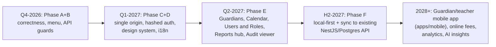

# 15 — 2030 Upgrade Roadmap (incremental, on the existing codebase)

| Horizon | Theme | Builds on existing |
|---|---|---|
| Now | Correct numbers, safe menu, closed API holes | dashboard, Sidebar, teacherRBACService, NestJS guards |
| 6 months | One product feel: shared components, full Bangla/English via `languageService` | existing Tailwind styles, TRANSLATIONS dictionary |
| 12 months | Multi-device: sync school data through existing `syncQueueService` ↔ `/api/v1/sync` with per-device auth; server-side RBAC | Prisma models already present |
| 2028+ | Guardian portal & app (Expo stub exists), SMS/online payment integration, early-warning analytics (attendance + results) | `apps/mobile`, `smsService`, resultService |

Non-goals: framework rewrite, database replacement, big-bang migration.
